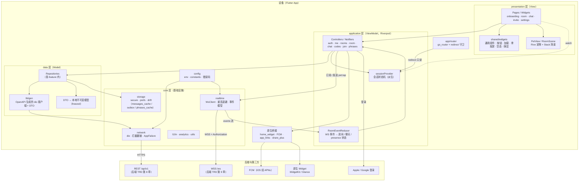
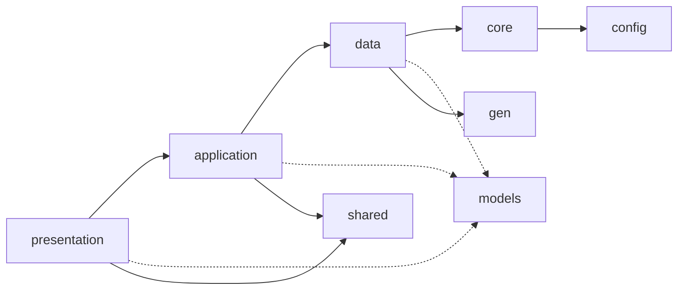
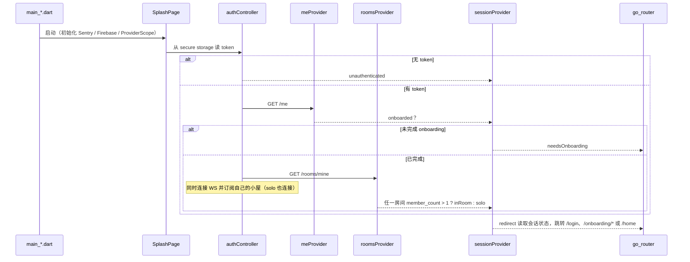
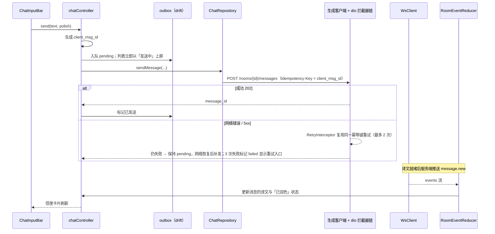
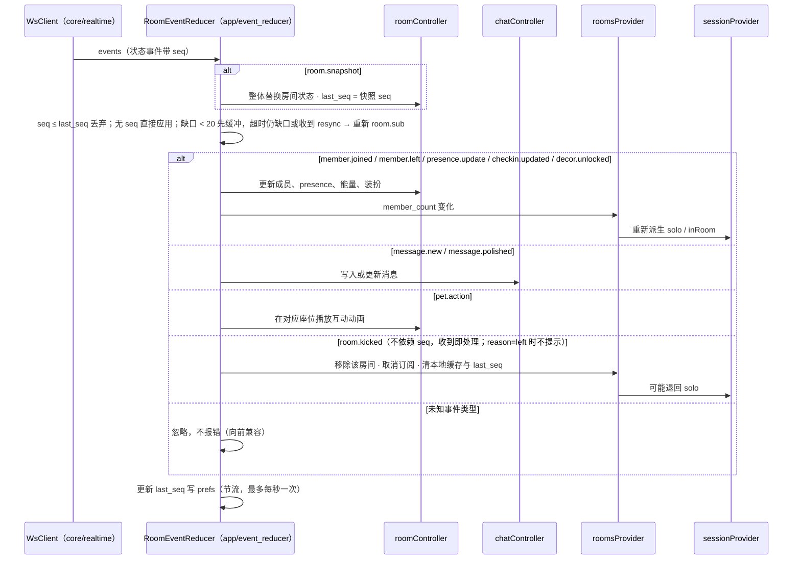
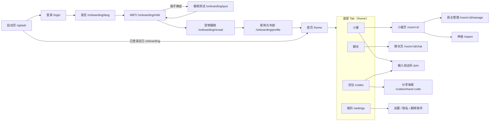

# 前端技术设计文档（TRD）：PetBridge（Flutter）

| 项目 | 内容 |
| :-- | :-- |
| 版本 | v1.8（草案，待自评审；较 v1.7：刷新 token 失败只在服务端拒绝时登出，两个 token 存在同一个键里一次写入，新增 `NOT_READY` 文案。v1.7 较 v1.6：对齐后端 TRD v1.7 的 MBTI 语气重构规则，信使卡片处理润色回退（“未润色”）。v1.6 较 v1.5：F0 联调后补齐实现细节：界面语言的取值顺序、启动时网络失败可重试、Google 取消与无账号不报错、设备时区回落、可空枚举的契约写法。v1.5 较 v1.4：对齐后端 TRD v1.5 的 WebSocket 加固：处理关闭码 4401、升级 429 / 503 与 `room.sub` 限流。v1.4 较 v1.3：对齐后端 B4 的 WebSocket 协议，reducer 改为以订阅快照为准，presence 只有在线 / 离线、离线显示为睡觉。v1.3 较 v1.2：对齐 PRD v1.5 与后端 TRD v1.3，F0 登录与 onboarding 设计定稿，首页改为四个 Tab，契约生成改用 swagger_parser） |
| 对应 PRD | 《跨国 MBTI 情感 AI 电子宠物 PRD v1.7》 |
| 配套文档 | 《后端 TRD（Go）v1.8》：REST 接口见其第 8 章，WebSocket 协议见其第 9 章，本文以其为准 |
| 技术栈 | Flutter 3.x 稳定版 / Dart 3 |
| 平台 | iOS 15+、Android 8+（竖屏，手机优先，不适配平板） |
| 开发模式 | **单人全栈开发**，选型以“一个人能长期维护”为第一约束 |

> **变更记录**：每个版本的变更说明见同目录《前端技术设计文档（TRD）变更记录》，新版本在最上面。
>
> 标记【假设】的是 PRD 没写清、由本文做出的设计决定，汇总在第 21 章。

---

## 1. 设计前提与原则

1. **契约驱动。** 前后端都是你一个人写，最容易错的是“字段对不上”。用 `openapi.yaml` 生成 Dart 客户端与模型，手写的网络代码只保留拦截器和 WebSocket。
2. **先跑通链路，再打磨视觉。** 16 只宠物的美术资源是最大的外部依赖，开发前期一律用**同一套占位宠物**，通过统一的动画接口（第 10 章）接入，美术到位后只替换资源，不改代码。
3. **服务端是真相来源。** 验证码是否有效、房间是否已满、能否润色，客户端只做格式预校验和展示，不推断业务结论。
4. **状态单向流动。** UI 只读状态，用户操作进入 controller，controller 调用 repository，结果回到状态。
5. **弱网优先。** 乐观更新 + 幂等重试 + 离线发送队列，网络抖动不应该让用户看到报错。
6. **原生代码最小化。** 只有桌面 Widget 和少量平台配置需要原生，其余都在 Dart 里完成。

---

## 2. 范围与平台策略

| 项 | 决定 |
| :-- | :-- |
| 设备 | 手机竖屏锁定；不做平板与横屏适配 |
| 主题 | MVP 仅亮色；暗色模式列为 P2 |
| 字体 | 使用系统字体，**不打包 CJK 字体**（省 10MB 以上体积）；按 Locale 自动选择简繁日韩字形 |
| 无障碍 | 支持系统字号缩放，范围限制在 0.8–1.3；核心控件语义标签齐全；对比度不低于 4.5:1 |
| 地区 | JP / KR / TW；中国大陆暂不首发，其推送与分发差异见第 15 章与第 21 章 |
| 语言 | 日、韩、繁中、简中、英，见第 13 章 |

---

## 3. 技术选型

| 层 | 选型 | 理由 / 备注 |
| :-- | :-- | :-- |
| 状态管理 | `flutter_riverpod`（配合 `riverpod_generator`） | 依赖注入与状态一体，测试方便；生成器减少样板 |
| 路由 | `go_router` | 声明式路由 + redirect 守卫，深链接天然支持 |
| 网络 | `dio` + OpenAPI 生成客户端（`swagger_parser`，纯 Dart） | 与后端 `openapi.yaml` 同源，见第 8 章；不用 `openapi-generator`（依赖 Java，Windows 上配置麻烦）（v1.3） |
| 模型 | 生成代码 + `freezed`（仅用于本地状态模型） | 不可变状态，`copyWith` 与联合类型 |
| WebSocket | `web_socket_channel`（`IOWebSocketChannel`） | 升级请求可带 `Authorization` 头，与后端约定一致 |
| 本地数据库 | `drift`（SQLite） | 消息缓存、离线发送队列 |
| 轻量存储 | `shared_preferences` | 语言、开关、各房间 `last_seq` |
| 密钥存储 | `flutter_secure_storage` | access / refresh token |
| 动画 | **Rive**（宠物与小屋动效）；`lottie` 备选（简单图标动效） | 状态机输入便于统一 16 只宠物的接口；文件小 |
| 小屋渲染 | Flutter 原生 `Stack` + Rive，**不引入游戏引擎** | 同屏最多 5 只宠物，原生足够；`flame` 仅在后续出现镜头、粒子系统时评估 |
| 国际化 | `flutter_localizations` + `intl`（ARB，`gen-l10n`） | 官方方案 |
| 登录 | `sign_in_with_apple`、`google_sign_in`（v7） | 与后端一致，MVP 只做这两种；Google 的 `serverClientId` 用 Web 客户端 ID（与后端 `GOOGLE_CLIENT_ID` 相同）；Apple 登录在 F0 只做按钮与接口层，上架 iOS 前补齐 |
| 时区 | `flutter_timezone` | 取设备 IANA 时区名，提交 onboarding 的 `tz` |
| 推送 | `firebase_messaging` + `flutter_local_notifications` | 见第 15 章 |
| 深链接 | `app_links` | Universal Links / App Links |
| 分享 | `share_plus` + `RepaintBoundary` 截图 | 海报图生成，调用系统分享面板 |
| 二维码 | `qr_flutter` | 海报上的邀请二维码 |
| Widget 桥接 | `home_widget` + 原生 WidgetKit / Glance | 见第 14 章 |
| 监控 | `sentry_flutter`；`firebase_analytics`（或 PostHog） | 崩溃与埋点 |
| 测试 | `flutter_test`、`mocktail`、`alchemist`（golden）、`integration_test` | 见第 19 章 |
| 静态检查 | `very_good_analysis` | 严一点的 lint，单人开发更需要 |
| CI / 分发 | GitHub Actions 跑测试；Codemagic 或 Fastlane 负责签名与分发到 TestFlight / Play 内测 | iOS 签名自动化能省大量时间 |

**刻意不选**：Bloc（对单人而言样板偏多）、GetX（可维护性差）、自写网络层（已有契约生成）、Unity / Flame 做小屋（体积与复杂度不划算）。

---

## 4. 总体架构

### 4.1 系统总览



**读图要点：**

- **数据只往一个方向流**：用户操作 → Controller → Repository → 网络 / 本地库；结果回到 Controller 的状态，Widget 只 `watch`。WS 事件不直接碰页面，先进 `RoomEventReducer`，再更新 Controller 状态。
- **`sessionProvider` 是路由的唯一依据**：`go_router` 的 `redirect` 只读取它（见 6.1），保证页面不会在不合法状态下被打开。
- **契约驱动**：`lib/gen` 由后端 `api/openapi.yaml` 生成，不手改；Repository 是唯一知道 DTO 的地方，往上只暴露本地不可变模型。
- **服务端是真相来源**：验证码是否有效、房间是否已满、能否润色，客户端只做格式预校验和展示。

### 4.2 分层职责

| 层 | 目录 | 职责 | 不允许做的事 |
| :-- | :-- | :-- | :-- |
| 入口与装配 | `lib/main_*.dart`、`lib/app/` | 读环境配置、初始化 Sentry / Firebase、挂载 `ProviderScope` 与 `MaterialApp.router`、主题、路由 | 不含业务逻辑 |
| presentation | `features/*/presentation/` | 页面与 Widget；只 `watch` provider、转发用户操作；表单本地校验（格式预校验） | 不直接调用网络、数据库、WS；不做业务判断 |
| application | `features/*/application/` | Riverpod Notifier / Controller（ViewModel）：持有界面状态、处理用户操作、编排 Repository；生成幂等键（`client_msg_id`） | 不 import Flutter UI 包；不直接使用 dio |
| data | `features/*/data/` | Repository：调用生成的 API 客户端与 drift，DTO ↔ 本地模型转换 | 不含界面状态；不依赖 presentation |
| model | `features/*/models/`、`shared/models/` | 不可变本地模型（freezed）、枚举；不依赖任何层 | 不含逻辑与 I/O |
| core | `core/` | 与业务无关的基础设施：dio 与拦截器、WsClient、secure / prefs / drift、l10n、analytics、通用工具 | 不 import `features/*` |
| shared | `shared/` | 跨 feature 复用的通用 Widget、跨 feature 共用的模型与 provider | 不 import `features/*` |
| config | `config/` | 环境变量封装（`--dart-define-from-file`）、常量、错误码枚举 | 业务代码不绕过它直接读 `String.fromEnvironment` |
| gen | `gen/` | OpenAPI 生成代码 | 不手改，CI 校验无差异 |

### 4.3 依赖规则（单向）



- 依赖方向：`presentation → application → data → core`；`models` 与 `config` 被各层引用，自身不引用上层。
- **feature 之间不互相 import 对方的 `presentation` 与 `data`**：需要对方的数据时，只能通过对方公开的 provider（`application` 层）或 `shared/` 里的共用模型。例如 `chat` 要知道“当前房间成员”，读 `room` 暴露的 `roomControllerProvider`，而不是 import `room` 的 Repository。
- `core` 与 `shared` 不 import `features/*`，保证基础设施和通用组件可以单独测试、复用。
- 跨 feature 的编排（如 `RoomEventReducer` 要同时更新房间、聊天、presence）放在 `app/event_reducer/`，由它调用各 feature 的 Controller 公开方法。

### 4.4 架构模式：MVVM（单向数据流）

本项目不使用 MVC（Flutter 的声明式 Widget 不需要 Controller 手动更新界面），也不引入完整的 Clean Architecture（会多出 domain 层与 UseCase，一个人维护样板过多）。对应关系如下：

| MVVM 角色 | 本项目对应 | 说明 |
| :-- | :-- | :-- |
| View | `presentation`：页面与 Widget | 只读状态，转发用户操作 |
| ViewModel | `application`：Riverpod 的 Notifier / Controller | 持有界面状态、处理用户操作、调用 Repository；目录名沿用 `application`，需要时也可改叫 `viewmodel` |
| Model | `data` + `models`：Repository、生成的 API 客户端、drift、不可变本地模型 | 数据来源与持久化，向上输出不可变模型；WsClient 在 `core/realtime`，由 application 层订阅 |

复杂业务逻辑出现时，再把它从 ViewModel 抽成独立的 domain 层，MVP 阶段不预先设计。

### 4.5 三条关键链路（跨层调用示意）

**① 启动与会话判定（决定路由去向，详见第 6 章）**



**② 发送消息（乐观更新 + 幂等重试，详见 11.4 与第 12 章）**



**③ WebSocket 事件入站（详见第 7、9 章）**



### 4.6 子系统解耦说明

- **实时通道与页面解耦**：`WsClient` 只暴露 `connectionState` 与 `events` 两个流，页面不接触 WS；房间页销毁只取消对应房间订阅，不关闭连接（连接是会话级的）。
- **宠物动画与代码解耦**：所有宠物实现同一份 Rive 接口契约（见第 10 章），`PetView` 只认 `pet_type` 与 `mood`；开发期统一用 `pet_placeholder.riv`，美术到位后只替换资源。
- **桌面 Widget 与主应用解耦**：`widget_bridge` 只负责把状态写入共享存储并触发刷新，原生 Widget 独立渲染，不运行 Flutter 代码（见第 14 章）。
- **埋点与业务解耦**：业务代码只调 `core/analytics` 的封装，不直接依赖具体 SDK（见 19.1）。
- **环境配置与业务解耦**：环境差异只出现在 `config/env.dart`，业务代码不读取 `String.fromEnvironment`（见 19.4）。

---

## 5. 项目目录结构（feature-first，feature 内分层）

在 feature-first 的基础上，每个 feature 内部再按 `data / application / presentation / models` 分层，对应 MVVM 的 Model / ViewModel / View；全局公共部分拆成 `config`、`core`、`shared`、`gen`。下表给出与常见前端工程分层的对应关系，便于对照：

| 常见前端分层 | 本项目对应 | 说明 |
| :-- | :-- | :-- |
| `api/` | `features/*/data/` + `gen/` + `core/network/` | 接口由 OpenAPI 生成（`gen/`），Repository 在各 feature 的 `data/`，dio 与拦截器在 `core/network/` |
| `assets/` | `assets/` | 图片、宠物 Rive、装扮、ARB、短语模板 |
| `components/` | `shared/widgets/` | 跨业务复用的通用 UI 组件；仅某 feature 使用的组件放该 feature 的 `presentation/widgets/` |
| `config/` | `config/` | 环境变量、常量、错误码枚举 |
| `hooks/` / `composables/` | `features/*/application/` + `shared/providers/` | Flutter 没有 hooks 概念，对应 Riverpod 的 provider 与 Notifier |
| `models/` / `types/` | `features/*/models/` + `shared/models/` | freezed 不可变模型 |
| `pages/` / `views/` | `features/*/presentation/pages/` | 页面级 Widget，按业务模块划分 |
| `router/` | `app/router/` | `go_router` 路由表、redirect 守卫 |
| `store/` / `services/` | `features/*/application/` + `core/storage/` | 状态在 Controller；本地持久化在 `core/storage/` |
| `utils/` | `core/utils/` | 格式化、校验、防抖等纯函数 |
| `main.ts` / `App.tsx` | `main_*.dart` + `app/app.dart` | 入口与根组件 |

```
petbridge_app/
├── lib/
│   ├── main.dart                         # 入口：调用 bootstrap（F0 只有 dev 环境；出现 staging / prod 时再拆 main_*.dart 与 flavor）
│   ├── app/                              # 应用装配（不含业务）
│   │   ├── app.dart                      # MaterialApp.router、主题、locale
│   │   ├── bootstrap.dart                # 初始化 Sentry / Firebase / 依赖覆盖，挂载 ProviderScope
│   │   ├── router/
│   │   │   ├── app_router.dart           # GoRouter 实例与 redirect（只读 sessionProvider）
│   │   │   ├── routes.dart               # 路由路径常量（对应 6.2 路由表）
│   │   │   └── deep_link.dart            # /j/{code} → /join?code= 解析与入参正则校验
│   │   ├── theme/                        # 颜色、字号（限制缩放 0.8–1.3）、组件主题
│   │   └── event_reducer/                # 跨 feature 的 WS 事件编排
│   │       └── room_event_reducer.dart   # 纯函数，必须有单元测试（见第 7 章规则 1–5）
│   ├── config/
│   │   ├── env.dart                      # --dart-define-from-file 的统一读取入口
│   │   ├── constants.dart                # 常量：容量上限、冷却、超时、缓存天数等
│   │   └── error_codes.dart              # 后端业务错误码枚举 → 本地化 key（err.{CODE}）
│   ├── core/                             # 与业务无关的基础设施（不 import features/*）
│   │   ├── network/
│   │   │   ├── dio_client.dart           # dio 实例、超时
│   │   │   ├── interceptors/             # auth（单飞刷新）、idempotency、retry、error_map、log
│   │   │   └── app_failure.dart          # AppFailure(code, retryAfter?, requestId)
│   │   ├── realtime/
│   │   │   ├── ws_client.dart            # 连接状态机、心跳、订阅；只暴露 connectionState / events
│   │   │   ├── ws_event.dart             # 事件模型（对应后端 TRD 第 9 章）
│   │   │   └── reconnect_policy.dart     # 1–30 秒退避 + 抖动、前后台策略
│   │   ├── storage/
│   │   │   ├── secure_store.dart         # access / refresh token
│   │   │   ├── prefs_store.dart          # 语言、开关、各房间 last_seq
│   │   │   └── db/                       # drift：messages_cache、outbox、phrases_cache
│   │   ├── l10n/                         # gen-l10n 生成的本地化类
│   │   ├── analytics/                    # 埋点封装（19.1 事件清单）
│   │   └── utils/                        # 格式化、校验器（验证码格式）、防抖、时钟
│   ├── shared/                           # 跨 feature 复用（不 import features/*）
│   │   ├── widgets/                      # app_button、loading、skeleton、empty_view、error_view、confirm_sheet、toast
│   │   ├── models/                       # 多个 feature 共用的模型（如 UserSummary、RoomSummary）
│   │   └── providers/                    # 跨 feature 的通用 provider（如 clock、connectivity）
│   ├── features/
│   │   ├── auth/                         # 登录（Apple / Google）、令牌、会话
│   │   │   ├── data/                     #   auth_repository.dart
│   │   │   ├── application/              #   auth_controller.dart、session_provider.dart
│   │   │   ├── models/                   #   session_state.dart
│   │   │   └── presentation/             #   pages/(splash、login) · widgets/
│   │   ├── onboarding/                   # 语言、MBTI、测试、宠物揭晓、昵称与年龄
│   │   │   ├── data/ · application/ · models/
│   │   │   └── presentation/             #   pages/(lang、mbti、quiz、reveal、profile) · widgets/
│   │   ├── pet/                          # 宠物资源注册表、PetView、动画接口（第 10 章）
│   │   │   ├── application/              #   pet_registry.dart
│   │   │   └── presentation/             #   pet_view.dart、pet_animation_controller.dart
│   │   ├── invite/                       # 背包、验证码输入、分享海报
│   │   │   ├── data/ · application/ (codes_provider、join_controller) · models/
│   │   │   └── presentation/             #   pages/(codes、share_poster、join) · widgets/(code_input、poster_canvas)
│   │   ├── room/                         # 小屋场景、成员、presence、打卡、装扮、房主管理
│   │   │   ├── data/ · application/ (rooms_provider、room_controller) · models/
│   │   │   └── presentation/             #   pages/(room、room_manage) · widgets/(room_scene、seat_anchor、decor_layer)
│   │   ├── chat/                         # 消息列表、信使卡片、输入栏、短语
│   │   │   ├── data/                     #   chat_repository.dart、outbox_dao.dart
│   │   │   ├── application/              #   chat_controller.dart、phrase_templates_provider.dart
│   │   │   ├── models/
│   │   │   └── presentation/             #   widgets/(courier_card、chat_input_bar、phrase_bar、message_list)
│   │   ├── safety/                       # 举报、屏蔽
│   │   ├── settings/                     # 语言、推送、隐私、删除账号
│   │   ├── home/                         # 底部 Tab 容器（小屋 / 聊天 / 背包 / 我的）
│   │   └── widget_bridge/                # 向原生 Widget 写数据（home_widget）
│   └── gen/                              # OpenAPI 生成的客户端与 DTO（不手改）
├── assets/
│   ├── images/                           # 通用图标、插画（WebP / SVG）
│   ├── pets/                             # pet_{pet_type}.riv（如 pet_happy_shiba.riv）（含占位 pet_placeholder.riv）与 Widget 静态图
│   ├── decor/                            # 装扮 WebP 与解锁前剪影
│   ├── l10n/                             # ARB（ja / ko / zh-Hant / zh-Hans / en）
│   └── phrases/                          # 随包的短语模板兜底版本
├── env/                                  # dev_android.json / local.json 等 --dart-define-from-file 配置（不含密钥）
├── ios/ (含 WidgetExtension)    android/ (含 Glance Widget)
├── test/                                 # 与 lib/ 同构；reducer、controller、repository 单测，golden
├── integration_test/
└── tool/                                 # gen_api.sh、导出资源等脚本
```

目录约定：

- **feature 内按需建目录**：不是每个 feature 都需要四个子目录（如 `pet`、`safety` 没有 `data/`），没有内容就不建空目录。
- **page 私有的组件放在自己 feature 的 `presentation/widgets/`**，只有被两个以上 feature 使用时才上移到 `shared/widgets/`，避免 `shared` 变成杂物间。
- **models 就近放置**：只在一个 feature 内使用的模型留在该 feature 内（模型很少时直接放在用到它的 `application/`，多了再建 `models/`）；被多个 feature 共用的才放 `shared/models/`。
- **生成代码隔离**：`gen/` 与 `core/l10n/` 下的生成文件不手改，CI 中校验生成结果无差异。
- **测试目录与 `lib/` 同构**，便于一眼找到对应的测试。

---

## 6. 路由与会话状态

### 6.1 会话状态机

路由由**一个 `sessionProvider`** 决定，它综合令牌、onboarding 完成度、房间情况：

```
unauthenticated ──登录成功──► needsOnboarding ──完成──► solo ◄──────────► inRoom
                                                         （单人模式）  任一在席房间成员数 > 1 时进入
                                                                       全部房间成员数都回到 1 时退回
```

`solo` 与 `inRoom` **不是单向迁移，而是由房间数据派生的两个状态**：

- **`inRoom` 的判定**：`roomsProvider` 里存在任一在席房间，其 `member_count > 1`。这涵盖两种情况：① 自己用码加入了他人的小屋；② **别人加入了自己的小屋**（v1.1 漏了这种情况）。
- **回到 `solo`**：自己退出他人小屋、被房主移除、房主解散，且自己的小屋也只剩自己一人时。
- `solo`：只显示个人页与单只宠物，小屋入口置灰并提示“输入验证码解锁”，与 PRD 的单人状态一致。
- `inRoom`：首页展示小屋场景；自己的小屋与已加入的小屋可切换【假设最多 2 间】。
- **WebSocket 在完成 onboarding 后即连接，`solo` 状态也连接**，并订阅自己所有在席房间（自己的小屋 + 已加入的小屋，v1.4 写明），这样别人加入时能实时收到 `member.joined` 并从 `solo` 切换到 `inRoom`。App 回到前台时额外调用一次 `GET /rooms/mine` 校正，防止错过事件。
- `go_router` 的 `redirect` 只读取 `sessionProvider`，保证页面不会在不合法状态下被打开。
- **F0 阶段**（小屋功能之前）先用四态：`unknown`（启动中）/ `unauthenticated` / `needsOnboarding` / `ready`；`ready` 在小屋阶段再细分为 `solo` / `inRoom`。
- **启动恢复会话**（v1.6）：有令牌时拉 `/me`；网络错误或 5xx 时保留令牌、停在 `unknown` 并带上错误，启动页显示错误文案与“重试”；其他失败（如刷新令牌失效）清除令牌，进入 `unauthenticated`。

### 6.2 路由表

| 路径 | 页面 | 说明 |
| :-- | :-- | :-- |
| `/splash` | 启动页 | 读令牌、拉 `/me`、决定去向；网络失败时显示“重试”（v1.6） |
| `/login` | 登录 | Apple / Google；用户取消或设备上没有 Google 账号时静默留在本页，其他失败显示 `err_GOOGLE_SIGN_IN_FAILED`（v1.6） |
| `/onboarding/lang` | 语言选择 | 默认跟随系统语言 |
| `/onboarding/mbti` | MBTI 选择 | 16 型网格；“不确定”进入测试 |
| `/onboarding/quiz` | 极简测试 | 见 11.1 |
| `/onboarding/reveal` | 宠物揭晓 | 出生动画 + 性格文案 |
| `/onboarding/profile` | 昵称与年龄区间 | 年龄门槛校验 |
| `/onboarding/too-young` | 未满 13 岁说明 | 只提供“退出登录”，不提交资料 |
| `/home` | 底部 Tab 容器 | 小屋 / 聊天 / 背包 / 我的（v1.3 起场景与聊天分为两个 Tab） |
| `/room/:id` | 小屋 | 场景（宠物、打卡、装扮）；聊天在“聊天”Tab |
| `/room/:id/chat` | 聊天 | 该房间的消息列表与输入栏 |
| `/room/:id/manage` | 房主管理 | 仅自己的小屋可进入：成员移除、解散，见 11.6 |
| `/codes`、`/codes/share/:code` | 背包与分享海报 |  |
| `/join` | 输入验证码 | 也可由深链接 `?code=` 打开 |
| `/settings/*` | 设置、隐私、删除账号 |  |
| `/report` | 举报 | 从宠物或消息长按进入 |

深链接：`https://<域名>/j/{code}` → `/join?code={code}`；入参先用正则校验，不合法直接忽略。

---

## 7. 状态管理设计

| Provider | 作用 | 数据来源 |
| :-- | :-- | :-- |
| `authControllerProvider` | 登录、登出、令牌 | 登录 API + secure storage |
| `meProvider` | 当前用户资料 | `GET /me` |
| `sessionProvider` | 路由用会话状态（派生） | auth + me + rooms |
| `roomsProvider` | 我的房间列表 | `GET /rooms/mine` + WS 事件 |
| `roomControllerProvider(roomId)` | 房间成员、presence、打卡、装扮 | 快照 + WS 事件 reducer |
| `chatControllerProvider(roomId)` | 消息列表、发送状态、润色状态 | drift 缓存 + REST + WS |
| `codesProvider` | 背包验证码 | `GET /codes` + `code.invalidated` |
| `joinControllerProvider` | 验证码输入流程、冷却倒计时 | `POST /rooms/join` |
| `phraseTemplatesProvider` | 短语模板（带版本） | 随包兜底 + `GET /config/phrases` |
| `uiLocaleProvider` / `nativeLangProvider` | 界面语言 / 母语 | prefs + `/me` |
| `wsClientProvider` | WebSocket 单例 | 完成 onboarding 后即连接（含 `solo`，用于接收“有人加入我的小屋”） |

**事件 reducer 规则**（`RoomEventReducer`，纯函数，必须有单元测试）：

1. 收到 `room.snapshot`：用快照**整体替换**该房间状态（成员、座位、presence），并把 `last_seq` **设为**快照的 `seq`，不取较大值（Redis 重启后服务端 seq 会从头开始）（v1.4）。
2. 带 `seq` 的事件（目前是 `member.joined`、`member.left`）：`seq ≤ last_seq` 直接丢弃，否则应用并更新 `last_seq`。缺口小于 20 时先缓冲、短暂等待；超时仍有缺口，对该房间重新发 `room.sub` 拿新快照（v1.4：不再拉 `GET /rooms/{id}`）。
3. 不带 `seq` 的事件（`presence.update`、`pet.action`、`room.kicked`、`code.invalidated`，以及服务端 Redis 故障时的 `member.*`）收到即应用，不改 `last_seq`（v1.4）。
4. 成员事件按 `user_id` **幂等**：`member.joined` 是“有则覆盖、无则加入”，`member.left` 是“有则删除、无则忽略”。快照与紧随其后的事件可能重复描述同一变化，必须幂等（v1.4）。
5. 收到 `resync`：对 `room_id` 指定的房间（缺省为全部已订阅房间）重新发 `room.sub`（v1.4）。
6. 不认识的事件类型**忽略而不是报错**，保证向前兼容。
7. 每次 `last_seq` 变化写入 prefs（节流，最多每秒一次）。
8. 收到 `room.kicked`（被房主移除、房间被解散，或自己在另一台设备上退出 `reason=left`）：取消该房间订阅，从 `roomsProvider` 移除，清除该房间的本地消息缓存与 `last_seq`，并重新计算会话状态（可能退回 `solo`）；该事件不依赖 `seq`，收到即处理。`left` 不弹提示，其余只提示“你已离开该小屋”。
9. 收到 `error` 帧：按 `ref` 找到对应的客户端帧；`room.sub` 得到 `ROOM_NOT_FOUND` 时，按房间已不存在处理（同规则 8，但不提示）（v1.4）。

---

## 8. 网络层

### 8.1 拦截器链（按顺序）

| 拦截器 | 职责 |
| :-- | :-- |
| `AuthInterceptor` | 附加 access token；收到 401 时**单飞刷新**：多个并发请求共享同一次 refresh，成功后重放。服务端拒绝刷新（400 / 401 / 403）时清空 token、登出并回到登录页；网络错误或 5xx 时保留 token，原请求以该失败（如 `NETWORK`）报错，之后再刷新（v1.8） |
| `IdempotencyInterceptor` | 对 `POST /rooms/join`、`/rooms/{id}/messages` 等写请求带 `Idempotency-Key` / `client_msg_id`；**重试时复用同一个键**，由 controller 生成、拦截器透传 |
| `RetryInterceptor` | 仅对网络错误、5xx、带幂等键的请求重试，最多 2 次，指数退避 + 抖动；4xx 业务错误不重试 |
| `ErrorMapInterceptor` | 把 `{error:{code}}` 映射为 `AppFailure(code, retryAfter?)`，UI 只认 `code` |
| `LogInterceptor` | 仅 debug；release 不记录请求体与响应体 |

### 8.2 约定

- 超时：连接 5 秒、接收 10 秒；润色相关请求单独放宽到 12 秒（服务端 6 秒超时 + 排队）。
- 错误码映射到本地化文案：`err.CODE_INVALID`、`err.ROOM_FULL` 等，文案放 ARB，**不显示服务端 `message`**。503 `NOT_READY`（服务重启、登录提供方暂时不可达）显示 `err_NOT_READY`“服务暂时不可用，请稍后重试”（v1.8）。
- `request_id` 随错误上报到 Sentry，便于和后端日志对上。
- 契约生成：用 `swagger_parser` 从后端仓库的 `api/openapi.yaml` 生成 `lib/gen/`（`dart run swagger_parser` + `build_runner`），CI 中校验生成结果无差异。
- 可空枚举（v1.6）：openapi 3.0.3 里 `nullable: true` 的枚举字段必须把 `null` 写进 `enum` 列表（如 Profile 的 `native_lang`、`age_band`），否则生成的模型遇到 `null` 解析失败，未 onboarding 用户的 `/me` 会报错；`contract_decode_test` 覆盖这种情况。
- F0 只启用 `AuthInterceptor`、`ErrorMapInterceptor`、`LogInterceptor`；`IdempotencyInterceptor` 与 `RetryInterceptor` 随入房 / 发消息阶段加入。

---

## 9. WebSocket 客户端

### 9.1 连接状态机

```
disconnected ─► connecting ─► connected ─(收到 hello)─► ready ─(room.sub 成功)─► subscribed
      ▲              │ 失败            │ 断开
      └──── 退避等待 ◄┴──────────────────┘
```

### 9.2 关键策略

| 项 | 策略 |
| :-- | :-- |
| 鉴权 | 升级请求头带 `Authorization: Bearer <access>`；token 即将过期（< 60 秒）先刷新再连；收到关闭码 **4401**（token 到期）先刷新 token 再立即重连，不走退避（v1.5） |
| 心跳 | 使用连接层 `pingInterval`（25 秒，与服务端 `hello` 下发值一致）；应用层不重复实现心跳 |
| 重连退避 | 1、2、4、8、16、30 秒，叠加 0–30% 抖动；连接稳定超过 60 秒后重置退避 |
| 前后台 | 进入后台 30 秒后主动断开以省电；回到前台立即重连并 `room.sub`（带各房间 `last_seq`） |
| `resync` | 对相应房间重新发 `room.sub`，用新快照覆盖本地状态；消息阶段（F3）另行拉取最近消息（v1.4：不再拉 `GET /rooms/{id}`） |
| `server.restart` | 随机等待 1–10 秒再重连，避免服务重启时所有客户端同时涌入；升级返回 503 `NOT_READY` 时同样处理（v1.5） |
| 限流（v1.5） | 升级返回 429 `RATE_LIMITED` 时按 `Retry-After` 等待；`room.sub` 收到 `error{RATE_LIMITED}` 时 1 秒后再订阅；缺口或 `resync` 引起的重新订阅要合并，同一房间 1 秒内不重复发 |
| 协议版本 | `hello.proto` 高于客户端支持的主版本，或 `hello.min_app_version` 高于当前 App 版本，或 REST 返回 HTTP 426 `UPGRADE_REQUIRED` → 弹出强制更新页（接口约定见后端 TRD 第 8、9 章） |
| 发送 | 仅 `pet.tap` 等轻量事件走 WS；消息发送与润色走 REST，保证幂等与可重试 |
| 状态指示 | 断线超过 3 秒才显示“正在重连”提示，避免闪烁 |

### 9.3 与 UI 的关系

`WsClient` 只暴露两个流：`connectionState` 与 `events`。**页面不接触 WS**，只观察 provider。房间页销毁时不关闭连接（连接是会话级的），只取消对应房间的订阅。

---

## 10. 小屋渲染与宠物动画

### 10.1 场景结构

```
RoomScene（固定比例容器，RepaintBoundary）
├── 背景层：房间底图（WebP）
├── 装扮层：已解锁装扮（按 item_id 摆放在预设锚点）
├── 宠物层：最多 5 个座位锚点（seat_no 1–5 → 固定坐标）
│     └── PetView(pet_type, mood, 昵称标签, 国旗角标)
└── 特效层：打招呼、打卡完成、装扮解锁的一次性动画
```

- 座位坐标用**相对比例**定义，适配不同屏幕宽高比；座位 1（房主）在中间偏前。
- 点击宠物：本地**立即播放**互动动画（乐观），同时通过 WS 发送 `pet.tap{room_id, target_user_id}`；收到他人的 `pet.action` 时在 `target_user_id` 的座位播放（服务端不会把 `pet.action` 发回给发起者）。
- 在线状态（v1.4）：成员 `presence` 为 `offline` 时 `PetView` 的 `mood=3`（睡觉），`online` 时回到待机；收到 `presence.update` 立即切换，所以用户回到 App 时同屋的人马上看到他的宠物醒来。

### 10.2 宠物动画统一接口（解耦美术与代码）

每只宠物的 Rive 文件必须遵守同一个**接口契约**，代码对宠物完全无感：

| 项 | 约定 |
| :-- | :-- |
| 文件 | `assets/pets/pet_{pet_type}.riv`（如 `pet_happy_shiba.riv`；后端只下发 `pet_type`），画板 512×512，一个状态机 `Main` |
| 数值输入 | `mood`：0 待机 / 1 开心 / 2 害羞 / 3 瞌睡 |
| 触发输入 | `greet`（打招呼）、`tap`（被轻触）、`deliver`（递送信件）、`celebrate`（打卡庆祝） |
| 专属动作 | MBTI 专属打招呼由 `greet` 触发，不同宠物内部实现不同（如 ENTJ 威严、INFP 害羞） |
| 占位 | `pet_placeholder.riv` 实现同样接口，开发期所有宠物统一使用它 |

**加载策略**：只加载当前场景里出现的宠物（最多 5 个）与自己的宠物，其余按需懒加载并缓存；离开房间页时释放。

**性能预算**：同屏动画不超过 5 个；应用进入后台或页面不可见时暂停动画；动画层包 `RepaintBoundary`；中低端 Android 真机（如骁龙 6 系列）保持 60fps，整体内存低于 250MB。

### 10.3 美术资源规范（交给美术前先定）

- 16 只宠物 × 状态机 4 个 mood + 4 个触发动画；导出静态图（待机/开心/瞌睡）供桌面 Widget 使用（Widget 不能跑 Rive，见第 14 章）。
- 装扮 10–15 件，WebP，统一锚点与透视；每件提供解锁前的剪影图。
- 单个 `.riv` 文件目标小于 200KB，总资源体积控制在 3MB 以内。

---

## 11. 核心页面设计要点

### 11.0 界面总览与线框大纲

以下为各核心页面的**低保真线框大纲**，只定义信息层级与主要交互，不规定视觉细节；视觉稿出来后以设计稿为准，线框仅用于对齐功能范围与组件拆分。竖屏手机，宽度按相对比例适配。

**页面导航关系**



**① 登录页**

```
┌──────────────────────────┐
│                          │
│        [ Logo / 宠物 ]    │
│        PetBridge         │
│     一句话产品定位文案      │
│                          │
│  [  Sign in with Apple ] │
│  [  Sign in with Google ]│
│                          │
│  《用户协议》《隐私政策》   │
└──────────────────────────┘
```

**② Onboarding（5 步，顶部进度条 + 返回）**

```
语言            MBTI               极简测试(4题)        宠物揭晓             昵称与年龄
┌────────┐   ┌────────────┐    ┌────────────┐    ┌────────────┐    ┌────────────┐
│ ○ 日本語 │   │ 16 型网格   │    │ 第 2 / 4 题 │    │  出生动画    │    │ 昵称 [____] │
│ ○ 한국어 │   │ [INTJ][INTP]│    │ 题干        │    │  [ 宠物 ]   │    │ 年龄区间    │
│ ● 繁中   │   │ [ENTJ]...  │    │ ( ) 选项 A  │    │  性格介绍    │    │ ( )13–17    │
│ ○ 简中   │   │ 或四维滑块  │    │ ( ) 选项 B  │    │             │    │ ( )18+      │
│ ○ English│   │ 我不确定 →  │    │             │    │ [ 继续 ]    │    │ [ 完成 ]    │
│ [ 继续 ] │   └────────────┘    └────────────┘    └────────────┘    └────────────┘
└────────┘
```

**③ 首页：底部 Tab 容器**

```
┌──────────────────────────┐
│ 状态栏 / 标题              │
├──────────────────────────┤
│                          │
│     当前 Tab 内容          │
│  小屋（solo 时：单只宠物    │
│  + “输入验证码解锁小屋”）   │
│                          │
├──────────────────────────┤
│ 小屋   聊天   背包   我的  │
└──────────────────────────┘
```

**④ 小屋 Tab 与聊天 Tab（核心页面；v1.3 起场景与聊天分为两个 Tab，顶部的房间切换两边共用）**

```
小屋 Tab                              聊天 Tab
┌──────────────────────────┐        ┌──────────────────────────┐
│ ← 小屋名/房间切换   ⋯ 设置  │        │ 小屋名/房间切换             │
├──────────────────────────┤        ├──────────────────────────┤
│  ┌────────────────────┐  │        │ 聊天列表（倒序，游标分页）   │
│  │ 背景 + 装扮层        │  │        │  （见下方信使卡片）         │
│  │  [宠物2]  [宠物1房主] │  │        │                          │
│  │  [宠物3]  [宠物4]    │  │        │                          │
│  └────────────────────┘  │        ├──────────────────────────┤
│  能量条 ▓▓▓▓░░   [打卡]   │        │ 常用短语 · 润色 · 输入框 ➤  │
├──────────────────────────┤        ├──────────────────────────┤
│ 小屋   聊天   背包   我的  │        │ 小屋   聊天   背包   我的  │
└──────────────────────────┘        └──────────────────────────┘
⋯：房主 → 管理；成员 → 退出小屋        solo 时显示“邀请朋友后就能在这里聊天”
```

聊天 Tab 的消息与输入栏细节：

```
┌──────────────────────────┐
│ 聊天列表（倒序，游标分页）   │
│  ┌ 信使卡片 ───────────┐  │
│  │ 🐱 昵称 🇯🇵          │  │
│  │ 译文 | 润色 | 原文    │  │  三态本地切换
│  │ [让 AI 润色]         │  │
│  └─────────────────────┘  │
├──────────────────────────┤
│ 常用短语： 早安 晚安 谢谢 …  │
│ [润色 ○] [ 输入框      ][➤]│
└──────────────────────────┘
```

**⑤ 验证码输入页**

```
┌──────────────────────────┐
│ ←  输入验证码              │
│                          │
│     [ XXXX - XXXX ]      │  自动大写、去空格与连字符
│     [ 粘贴 ]              │  不自动读取剪贴板
│     （错误/冷却倒计时文案）   │
│                          │
│     [   加入小屋   ]       │  格式不合法时不可点
└──────────────────────────┘
```

**⑥ 背包与分享海报**

```
背包                              分享海报（离屏 1080×1440 导出）
┌──────────────────────────┐    ┌──────────────────────┐
│ 我的验证码                 │    │      [ 宠物形象 ]      │
│ ┌──────────────────────┐ │    │   XXXX-XXXX           │
│ │ XXXX-XXXX  未使用 6天  │ │    │   小屋 2 / 5 人        │
│ │              [分享]    │ │    │   [ 邀请二维码 ]       │
│ ├──────────────────────┤ │    └──────────────────────┘
│ │ YYYY-YYYY  已使用      │ │    [ 保存 / 系统分享 ]
│ └──────────────────────┘ │
│ [ 生成验证码 ]（房主，未满）  │
└──────────────────────────┘
```

**⑦ 房主管理页（`/room/:id/manage`，仅自己的小屋）**

```
┌──────────────────────────┐
│ ←  管理小屋                │
│ 成员                       │
│  🐱 昵称A       [移除]     │  → 二次确认弹窗
│  🐶 昵称B       [移除]     │
│ ─────────────────────── │
│ [ 解散小屋 ]（红色，二次确认）│
└──────────────────────────┘
```

**⑧ 我的 / 设置**

```
┌──────────────────────────┐
│ 我的宠物 + 昵称 + MBTI      │
├──────────────────────────┤
│ 界面语言 / 母语            │
│ 推送开关 · Widget 隐私模式  │
│ 屏蔽列表                   │
│ 隐私政策 · 用户协议         │
│ 删除账号（二次确认）         │
│ 退出登录                   │
└──────────────────────────┘
```

**通用状态页（所有页面复用 `shared/widgets`）**：加载骨架屏、空态、断线“正在重连”顶部条（断线超过 3 秒才显示）、强制更新全屏页（`UPGRADE_REQUIRED`）、通用错误页（带重试）。

### 11.1 Onboarding

1. 语言：默认取系统语言，五选一，选中即切换界面语言并保存在本地。界面语言与“母语（翻译目标语言）”默认相同，设置里可分开【假设】。界面语言取值顺序（v1.6）：本地保存的选择 → `/me` 的 `native_lang` → 系统语言；退出登录清除本地选择，再次登录按 `native_lang` 恢复。
   进度条（v1.6）：共 5 步，语言 1、MBTI 2、测试与结果 3、揭晓 4、昵称与年龄 5；直接选 MBTI 时跳过第 3 步。
2. MBTI：16 型网格直选（F0 先不做四维滑块）；底部“我不确定”进入测试。
3. 极简测试：**4 题（每个 MBTI 维度 1 题，每题二选一）**，PRD v1.4 已同步；客户端本地计分，只提交结果。结果页显示 4 个字母，每个维度可点击翻转后再确认（PRD F1.3“可手动二次确认”），确认后回到 MBTI 页并选中结果。题目（v1.3 定稿，文案进 ARB）：

   | 维度 | 题目 | A | B |
   | :-- | :-- | :-- | :-- |
   | E / I | 忙了一周，周末你更想… | 约朋友出去热闹一下（E） | 自己待着充电（I） |
   | S / N | 朋友跟你讲一部新电影，你更想知道… | 讲了什么、谁演的（S） | 它想表达什么（N） |
   | T / F | 朋友做了个不太好的决定来问你，你会… | 直接分析哪里有问题（T） | 先照顾他的感受（F） |
   | J / P | 出去旅行，你通常… | 提前排好行程（J） | 到了再看心情（P） |

4. 宠物揭晓：出生动画 + 该宠物的性格介绍（五语种文案，16 × 5 共 80 条，进 ARB）。揭晓在提交之前，宠物由客户端按 MBTI 本地查 `pet_type`（与后端 `internal/service/pet.go` 映射一致，单测核对 16 个 slug 与 openapi 枚举相同）；资源按 `pet_type` 命名。F0 用占位宠物。
5. 昵称与年龄：昵称去首尾空格后 1–20 字、无控制字符（敏感词由服务端判定）；年龄三选一：未满 13 岁 / 13–17 岁 / 18 岁以上。选“未满 13 岁”进入 `/onboarding/too-young` 说明页，只提供“退出登录”，不提交；13–17 岁给出提示（私聊关闭等限制）。提交的 `tz` 取设备 IANA 时区；设备返回的不是 IANA 名（不含 `/`，如模拟器的 `GMT`）时提交 `UTC`（v1.6）。
6. 完成后调用 `POST /me/onboarding`（幂等，失败可原样重试）。
7. **权限不在首启就弹**：推送权限延迟到“首次加入小屋或首次分享验证码”之后，用一个应用内说明弹窗做预授权。

### 11.2 验证码输入页

- 8 位输入，自动转大写、去空格与连字符，展示为 `XXXX-XXXX`；格式不合法时按钮不可点（只做格式预校验，字符集 32 个）。
- 提供明确的\*\*“粘贴”按钮\*\*，不在页面打开时自动读取剪贴板（iOS 会弹粘贴提示，体验差且易引起审核疑问）。
- 结果处理：成功 → 入房动画 + 奖励验证码揭晓（礼盒动效）+ 引导分享；`ROOM_FULL`、`CODE_INVALID`、`ALREADY_MEMBER`、`AGE_RESTRICTED`、`ROOM_LIMIT`（已在 2 间房内，提示先退出已加入的小屋）各有独立文案；`CODE_COOLDOWN` 显示倒计时并禁用输入。
- 失败不清空已输入内容，便于用户修改。

### 11.3 背包与分享海报

- 背包列表：验证码、状态（未使用 / 已使用 / 已过期 / 已作废——满员与房主解散都会作废，对应后端 `void`）、剩余有效期；未使用的显示“分享”。
- 海报：离屏构建 1080×1440 的 Widget，`RepaintBoundary.toImage` 导出 PNG，含宠物形象、验证码、房间人数进度、二维码（`https://<域名>/j/{code}`）；字体使用系统字体，确保导出前已完成布局。
- 分享：调用系统分享面板（`share_plus`），同时附带文本与链接；**不接入 X / Instagram / 小红书各自的 SDK**【假设】，系统面板已覆盖，省去大量适配与审核成本。

### 11.4 小屋与聊天

- 场景在“小屋”Tab，聊天在“聊天”Tab（v1.3 起分开，原“上半场景、下半聊天”作废）；两个 Tab 共用顶部的房间切换，切到哪间房两边一起变。
- 输入栏：母语输入、**常用短语快捷条**（读取 `phraseTemplatesProvider`，点击发送 `phrase_id`，不触发 AI）、“AI 润色”开关（默认关）、发送按钮。
- 发送：生成 `client_msg_id`，先在列表中以“发送中”状态上屏，REST 成功改为“已发送”，失败显示重试（复用同一个 `client_msg_id`）。
- 列表：倒序 `ListView`，向上滚动用 `before` 游标分页；本地 drift 缓存最近 30 天（与后端保留期一致）。
- **信使卡片**（`CourierCard`）：
  - 头部为发送者的宠物与昵称，递送动画；
  - 正文区在三种内容间切换：基础译文 / AI 润色译文 / 原文，切换完全在本地；
  - 未润色时显示“让 AI 润色”按钮，点击调用 `POST /deliveries/{id}/polish`，进入加载态，结果由 `message.polished` 事件更新；
  - `message.polished` 的 `polish_status` 为 `fallback` 时（v1.7），润色结果没通过服务端校验：保持显示基础译文，润色一栏标“未润色”，不再显示“让 AI 润色”按钮（同一条再点大概率还是同样结果）；
  - 翻译未完成显示骨架屏；AI 不可用时显示原文 + “暂无法翻译”标记 + 重试入口。
- 长按宠物或消息：举报 / 屏蔽。

### 11.5 打卡与装扮

- 打卡按钮每天一次（以用户本地日期为准，服务端为准，按钮状态来自 `GET /rooms/{id}`）。
- 打卡成功：本地播放庆祝动画，能量条增长；收到 `decor.unlocked` 时在装扮层播放解锁动效。

### 11.6 房主管理（v1.2 新增，对应 PRD R10/R11、后端 TRD 7.8）

**可见性**：以下入口只在**自己的小屋**（`room.owner_id == me`）出现；他人小屋里的成员只看到“退出小屋”。前端隐藏入口只是体验优化，权限以服务端 `NOT_ROOM_OWNER` 为准。

| 功能 | 入口与交互 | 接口 / 事件 |
| :-- | :-- | :-- |
| 移除成员 | 成员列表或长按宠物 → 底部弹层“移除出小屋” → 二次确认弹窗（说明对方将无法再加入此小屋）；成功后该座位播放离开动画 | `DELETE /rooms/{id}/members/{user_id}`；幂等，重复提交按成功处理；其他成员收到 `member.left{reason:kicked}` |
| 解散 | `/room/:id/manage` → “解散小屋” → 二次确认（说明将移出所有成员并作废未使用的验证码）；成功后回到仅自己一人的小屋 | `POST /rooms/{id}/dissolve` |
| 自助补码 | 背包页在小屋未满时显示“生成验证码”按钮；成功后新码出现在列表顶部并可直接分享；满员时按钮置灰并提示“先腾出空位” | `POST /rooms/{id}/codes`；失败按 `details.reason` 展示：`room_full`、`enough_unused`（已有足够的未使用验证码）、`daily_limit`（今日次数已用完）、`lifetime_limit` |
| 退出小屋 | 仅他人小屋显示；房主在自己的小屋里**不显示**“退出”，只显示“解散” | `POST /rooms/{id}/leave`；若误触发 `OWNER_CANNOT_LEAVE`，提示使用“解散” |

**被移除一方的体验**：收到 `room.kicked` 后（见第 7 章 reducer 规则 5），若正停留在该房间页则退回首页并弹轻量提示“你已离开该小屋”；**不展示被移除还是被解散的区别，也不展示操作者**，避免冲突升级。若随后用同房间的新码重试入房，会得到 `CODE_INVALID`，文案保持“验证码已失效”，不暗示被拉黑。

---

## 12. 本地存储与离线

| 存储 | 内容 | 说明 |
| :-- | :-- | :-- |
| `flutter_secure_storage` | access / refresh token | 两者以 JSON 存在同一个键 `auth_tokens`，一次写入，不会只写一半（v1.8；旧版的 `access_token` / `refresh_token` 两个键首次读取时迁移）。Keychain / Keystore，卸载重装不保证保留 |
| `shared_preferences` | UI 语言、推送开关、Widget 隐私模式、各房间 `last_seq`、onboarding 完成标记、短语模板版本 | 轻量键值 |
| `drift`（SQLite） | `messages_cache`、`outbox`、`phrases_cache` | 见下 |

**消息缓存**：按 `room_id + message_id` 存最近 30 天，进房时先读本地渲染，再增量拉取，让界面秒开。

**离线发送队列（outbox）**：

1. 发送时先入队（`client_msg_id`、房间、内容、状态 = pending）。
2. 在线则立即发 REST；成功后更新状态并写入缓存。
3. 离线或失败：保持 pending，网络恢复（`connectivity_plus` 事件）或 WS 重连成功后按时间顺序补发。
4. 重试 3 次仍失败 → 标记 failed，在列表中显示重试入口；**重试沿用原 `client_msg_id`**，服务端幂等保证不重复。
5. 单条消息离线停留超过 24 小时自动标记失败，避免“过期消息”突然发出去。

**登出/删除账号**：清空 secure storage、prefs 与整个 drift 数据库。

---

## 13. 多语言（i18n）

| 项 | 决定 |
| :-- | :-- |
| 语言 | `ja`、`ko`、`zh-Hant`（台湾）、`zh-Hans`（简体）、`en`；用 `Locale.fromSubtags` 区分简繁，避免字形串用 |
| 文案 | ARB 文件 + `gen-l10n`；key 按功能分组：`onb.*`、`room.*`、`err.*`、`pet.*` |
| 组件本地化 | 界面组件来自 `material_ui`，本地化代理用 `AppLocalizations.delegate` + `material_ui` 的 `GlobalMaterialLocalizations.delegates`，不用 `gen-l10n` 默认带的 `flutter_localizations` 代理（后者 `material_ui` 读不到，非英文下顶部栏报错）（v1.6） |
| 宠物文案 | 16 型 × 5 语言 = 80 条性格介绍，与专属打招呼文案一起放 `pet.*` |
| 错误码 | 每个后端 `code` 对应 `err.{CODE}`，缺失时回落到通用文案 |
| 复数与日期 | 使用 `intl` 的 ICU 复数；日期按用户时区与 Locale 格式化 |
| 界面语言 vs 母语 | 界面语言只影响本地展示；**母语**决定翻译目标语言，修改受后端“30 天一次”限制 |
| 字体 | 系统字体；`Text` 显式传 Locale 以保证简繁字形正确 |
| 布局 | 日韩文案较长，所有控件禁止写死宽度；每次发版跑一遍五语言 golden 截图 |
| 翻译流程 | 英文为源语言，日/韩/繁中先用 AI 初译再人工校对关键流程（onboarding、验证码、隐私与举报），其余可迭代 |

---

## 14. 桌面 Widget（原生部分，风险最高）

### 14.1 架构

```
Flutter App ──home_widget.saveWidgetData──► 共享存储
                                           │ iOS：App Group 的 UserDefaults
                                           │ Android：SharedPreferences
          ──home_widget.updateWidget──► 触发刷新

iOS：WidgetKit（SwiftUI）读取共享存储渲染
Android：Jetpack Glance（或 RemoteViews）读取共享存储渲染
```

### 14.2 关键决定

| 项 | 决定 |
| :-- | :-- |
| 渲染 | Widget **不能运行 Rive**，使用美术导出的静态宠物图（每只 × 待机/开心/瞌睡）；16 × 3 = 48 张，放在 Widget 扩展资源中 |
| 数据 | App 在前台时（打开、收到 WS 事件、回到前台）把最新状态写入共享存储并触发刷新 |
| 后台更新 | 收到后端的 data-only 推送 `{type:"widget.refresh"}` 时更新共享存储并刷新 Widget（后端 TRD 7.7；iOS 系统会节流静默推送，**不保证送达**，故 Widget 上标注更新时间）；Widget 添加/移除时通过 `PUT /devices/current` 上报 `widget_installed`；Widget 自行定时请求 `GET /widget/snapshot` 作为 **P1**（需共享令牌，涉及 Keychain access group，工时大，先不做） |
| 单人状态 | 展示“单只宠物打瞌睡 / 等待搭子”，不依赖网络 |
| 入房后 | 展示成员宠物状态与最新信使消息摘要 |
| 隐私 | iOS 使用 `privacySensitive` 修饰消息文本，锁屏自动遮蔽；Android 无法判断锁屏，默认只展示摘要，设置里可选择隐藏正文 |
| 刷新预期 | 系统调度，iOS 约 15–30 分钟、Android WorkManager 最短 15 分钟；产品文案不能承诺“实时”，Widget 上标注更新时间 |
| 尺寸 | MVP 只做一个中号尺寸；小/大号列为后续 |

> **工时提醒**：这是一人开发里最容易低估的一块。iOS 与 Android 两端各一套原生代码、两套资源、两套调试方式，预留 **2 周**，并且在第 11–12 周才开始，不阻塞主流程。

---

## 15. 推送与深度链接

### 15.1 推送

- 登录成功及 token 刷新时调用 `PUT /devices/current` 登记 FCM token、语言、时区。
- **请求权限的时机**：首次加入小屋或首次分享验证码之后，先弹应用内说明（预授权），用户同意后再触发系统弹窗；Android 13+ 需要 `POST_NOTIFICATIONS`。
- 前台收到推送：App 内已有 WS 时不展示系统通知，只更新应用内状态。
- 点击跳转：payload 带 `type` 与 `room_id`，通过 `go_router` 路由到对应房间。
- Android 通知渠道：信使消息、小屋动态、打卡提醒三个渠道，用户可单独关闭。
- **中国大陆 Android**：暂不首发；日后进入时 FCM 不可用，需要各厂商推送或聚合服务，**不在 MVP 范围**（与后端 18.1 第 6 条一致）。

### 15.2 深度链接与新用户安装

| 场景 | 方案 |
| :-- | :-- |
| 已安装用户点击分享链接 | Universal Links（iOS）/ App Links（Android）→ `/join?code=`；需要在域名上托管 `apple-app-site-association` 与 `assetlinks.json`（由后端 Caddy 提供） |
| 未安装用户点击链接 | 打开静态落地页（含商店跳转）；是否接入“延迟深度链接”归因服务（Branch / AppsFlyer OneLink）待定【假设】。注意 **Firebase Dynamic Links 已停止服务**，不要使用 |
| 兜底（必须有） | 新用户安装后，在验证码输入页提供“粘贴验证码”按钮，海报上直接显示验证码，保证即使没有深链也能入房 |
| 校验 | 所有链接入参用 `^[2-9A-HJ-NP-Z]{8}$` 校验后才使用 |

---

## 16. 性能与体积

| 指标 | 目标 |
| :-- | :-- |
| 冷启动到可交互 | 中端设备 ≤ 2 秒 |
| 安装包 | iOS ≤ 40MB；Android 使用 App Bundle，按 ABI 拆分，单设备下载 ≤ 30MB |
| 帧率 | 小屋场景 60fps（中低端 Android 真机验证） |
| 内存 | 小屋场景 ≤ 250MB |
| WS 重连后恢复 | ≤ 2 秒内状态一致 |

**手段**：

- 宠物与装扮资源懒加载、WebP、`.riv` 控制体积；不打包 CJK 字体；`--tree-shake-icons`。
- `const` 构造、`ref.watch(provider.select(...))` 精确订阅，避免大范围重建。
- 聊天列表使用 `ListView.builder`；动画层包 `RepaintBoundary`；图片使用 `cacheWidth/cacheHeight` 解码缩小。
- 启动路径只做必要初始化（读令牌、读 prefs），其余（Sentry、分析、推送）在首帧后延迟初始化。
- 使用 `flutter run --profile` + DevTools 在 **真机** 上测，不以模拟器为准；至少覆盖一台低端 Android。

---

## 17. 安全与隐私

| 事项 | 做法 |
| :-- | :-- |
| 令牌 | 仅存 secure storage；不写日志；登出清除 |
| 密钥 | 客户端不放任何 LLM 或第三方私钥，所有 AI 调用只走后端 |
| 传输 | 全程 HTTPS / WSS；证书固定（pinning）作为 P2，证书轮换成本高，先不做 |
| 混淆 | 发布构建使用 `--obfuscate --split-debug-info`，符号文件上传 Sentry |
| 深链/剪贴板 | 参数严格校验；不自动读剪贴板 |
| 日志 | release 不记录请求体、消息正文、验证码 |
| 分析 | 事件中不带消息内容与昵称；用户可在设置中关闭分析；若接入归因 SDK，评估 iOS ATT 与隐私清单影响 |
| 商店合规 | 填写 App Store 隐私营养标签与 Google Data Safety；**UGC 应用必须有举报、屏蔽、用户协议确认与联系方式**（Apple 审核指南对用户生成内容的要求），年龄分级按聊天功能如实选择 |
| 账号删除 | 设置内提供“删除账号”，二次确认后调用 `DELETE /me`，并清空本地全部数据（商店硬性要求） |
| 审核账号 | 验证码只能通过 P2P 获得，**提交审核时必须在备注里提供一个有效的种子验证码和测试账号**，否则审核人员进不了小屋 |

---

## 18. 错误处理与降级体验

| 场景 | 体验 |
| :-- | :-- |
| 离线 | 顶部细条提示“当前离线”；消息可发送并进入队列；已缓存内容可浏览 |
| WS 断线 | 3 秒后显示轻量“重连中”；自动重连与补发，无需用户操作 |
| 发送失败 | 消息气泡下显示重试；不弹阻断式对话框 |
| 翻译不可用 | 卡片显示原文 + “暂无法翻译” + 重试，不丢消息 |
| 润色额度用尽 | 按钮置灰并提示“明天再来”（`QUOTA_EXCEEDED`） |
| 润色被服务端回退（`polish_status = fallback`，v1.7） | 卡片显示基础译文，润色一栏标“未润色”，不弹提示、不提供重试 |
| 验证码冷却 | 倒计时展示，输入框禁用 |
| 房间已满 | 友好提示，并提供“用我自己的验证码邀请朋友”入口 |
| 被房主移除 / 房间被解散 | 轻量提示“你已离开该小屋”，退回首页；不展示原因与操作者（见 11.6） |
| 自助补码被拒（`CODE_ISSUE_LIMIT`） | 按 `details.reason` 展示对应文案，按钮不进入加载死循环 |
| 服务繁忙（503/`RATE_LIMITED`） | Toast 提示并按 `Retry-After` 退避，不连续自动轰炸 |
| 房间不存在或已无关（`ROOM_NOT_FOUND`） | 刷新房间列表，退回首页 |
| 未完成 onboarding（`ONBOARDING_REQUIRED`） | 刷新 `/me`，会话回到 `needsOnboarding`，跳转 onboarding |
| 已在该房间（`ALREADY_MEMBER`） | 用 `details.room_id` 直接进入该房间 |
| 版本过旧 | 全屏强制更新页，跳转商店 |
| 未捕获异常 | 全局 `FlutterError.onError` / `PlatformDispatcher.onError` 上报 Sentry，显示通用错误页而不是白屏 |

---

## 19. 埋点、测试与发布

### 19.1 埋点（与 PRD 12.3 对应）

`signup_complete`、`mbti_selected`、`quiz_started`、`code_issued`、`code_shared`（带渠道）、`code_entered_success/fail`（带失败原因）、`room_joined`、`message_sent`（带是否润色、是否短语）、`polish_toggled`、`original_viewed`、`pet_tapped`、`checkin_done`、`widget_added`、`push_permission_result`、`report_submitted`。统一在 `core/analytics` 封装，业务代码不直接依赖具体 SDK。

### 19.2 测试策略

| 类型 | 重点 |
| :-- | :-- |
| 单元测试 | `RoomEventReducer`（去重、乱序、缺口、resync）、验证码格式化与校验、outbox 状态流转、会话状态机 |
| Widget / Golden | 信使卡片的各状态（翻译中、基础译文、已润色、原文、不可用）、验证码输入页的各错误态、分享海报、五语言长文案溢出检查 |
| 集成测试 | `integration_test` 对本地后端（本机原生 PostgreSQL + Memurai，go-task 启动）跑通：登录 → onboarding → 入房 → 发消息 → 收到事件 |
| 真机矩阵 | iPhone SE 与较新机型各一台；Android：一台低端机、一台主流机；每次发版手测核心流程 |
| 手动脚本 | 断网/弱网、杀进程重启、前后台切换、后端重启时重连 |

### 19.3 发布流程

- 三套环境：`dev` / `staging` / `prod`，用 `--dart-define-from-file` 注入域名与开关，三个独立 Bundle ID 便于同机并存。
- 版本号：语义化版本 + CI 自增 build number。
- CI：GitHub Actions 跑 `analyze` + 测试 + 契约生成无差异检查；打包签名交给 Codemagic / Fastlane，产出分发到 TestFlight 与 Play 内测轨道。
- 灰度：按地区逐步放量（先台湾，再日韩）；预留 1–7 天商店审核时间，**首次提审预计会被问及 UGC 与 AI 内容，提前准备好说明**。
- 强制更新：见 9.2 节与第 18 章，接口见后端 TRD 第 8、9 章。

---

### 19.4 环境配置（`--dart-define-from-file`）

Flutter 没有 `.env` 机制，用 JSON 文件加 `--dart-define-from-file` 在构建时注入，代码里用 `String.fromEnvironment` 读取。统一封装在 `config/env.dart`，业务代码不直接读取。

| 文件 | 用途 | 入库 |
| :-- | :-- | :-- |
| `env/dev_android.json` | Android 模拟器连本机后端 | 是 |
| `env/dev_ios.json` | iOS 模拟器连本机后端（有 Mac 后再建） | 是 |
| `env/local.json` | 真机连电脑局域网 IP（每人不同） | 否，写进 `.gitignore` |
| `env/staging.json` | 预发（有预发环境后再建） | 是 |
| `env/prod.json` | 线上（上线前再建） | 是 |

F0 只有 `env/dev_android.json` 与 `env/local.json`，键随功能逐步加入：

```json
{
  "ENV": "dev",
  "API_BASE_URL": "http://10.0.2.2:8090/api/v1",
  "GOOGLE_SERVER_CLIENT_ID": "234594731344-fkbbq90jse9giqlmlkrn3qgjn3om9c8r.apps.googleusercontent.com",
  "DEV_LOGIN": true,
  "APPLE_LOGIN_ENABLED": false
}
```

后续阶段再加入 `WS_URL`（`ws://10.0.2.2:8090/api/v1/ws`，v1.4 起与 REST 同一基础路径）、`SHARE_BASE_URL`、`SENTRY_DSN`、`ANALYTICS_ENABLED`。

| 键 | 含义 |
| :-- | :-- |
| `ENV` | dev / staging / prod，用于日志与埋点区分 |
| `API_BASE_URL`、`WS_URL` | 与后端 TRD 第 8、9 章的路径一致 |
| `SHARE_BASE_URL` | 分享海报二维码与深链的域名（上线前替换为真实域名） |
| `SENTRY_DSN` | 本地留空 |
| `ANALYTICS_ENABLED` | 本地与预发默认关闭，避免污染线上数据 |
| `DEV_LOGIN` | 为 true 时登录页才出现“开发登录”入口；staging 与 prod 为 false，并用 `const bool.fromEnvironment` 让该分支在发布包里被剔除 |
| `GOOGLE_SERVER_CLIENT_ID` | Google OAuth **Web 客户端** ID（非机密），传给 `google_sign_in` 的 `serverClientId`，与后端 `GOOGLE_CLIENT_ID` 相同；Android 端另需在 Google Cloud 登记包名 `io.github.jinheng0301.petbridge` + 签名 SHA-1 的 Android 客户端 |
| `APPLE_LOGIN_ENABLED` | false 时 Apple 按钮点击只提示“即将开放” |

**规则**：客户端不放任何密钥（与第 17 章一致）。Google / Apple 登录用到的 Client ID 与 Firebase 配置文件属于平台工程配置，不是机密，按 flavor 放在各自目录（`google-services.json`、`GoogleService-Info.plist`），dev、staging、prod 使用不同的 Firebase 项目。

### 19.5 本地开发与联调

先在本地和后端跑通，再进预发。

1. **启动后端**：按后端 TRD 15.5 执行 `task up`、`task migrate`、`task seed`、`task dev`（Windows 用 go-task；worker 尚未实现，消息阶段再加）。
2. **生成 API 客户端**：`dart run swagger_parser` 后 `dart run build_runner build`。
3. **启动 App**：

```
flutter run --dart-define-from-file=env/dev_android.json
flutter run -d <真机ID> --dart-define-from-file=env/local.json
```

4. **登录**：dev 构建的登录页有“开发登录”，输入种子邮箱（如 `dev-a@local`）即可，调用后端 `POST /auth/login/dev`，不需要 Apple / Google 账号。
5. **多人联调**：开两个设备（Android 模拟器 + iOS 模拟器），分别登录种子用户 A、B；用种子验证码 `DEVA2345` 测试入房。

**本机后端地址**

| 运行位置 | 后端地址 | 备注 |
| :-- | :-- | :-- |
| Android 模拟器 | `http://10.0.2.2:8090` | 模拟器访问宿主机的固定地址；端口以后端 `.env` 的 `APP_PORT` 为准（默认 8090） |
| iOS 模拟器 | `http://localhost:8090` | 需要 Mac |
| 真机（同一 Wi-Fi） | `http://<电脑局域网 IP>:8090` | 后端监听 `0.0.0.0`，防火墙放行 8090 |
| Android 真机（USB） | 先执行 `adb reverse tcp:8090 tcp:8090`，再用 `http://localhost:8090` | 不依赖 Wi-Fi |

**明文流量**：本地后端是 `http` 与 `ws`，不是 `https` 与 `wss`。Android 只在 debug 与 profile 的 manifest 里允许明文流量；iOS 只在 dev flavor 的 `Info.plist` 加本地网络例外，staging 与 prod 一律不允许。

**联调清单**

| 场景 | 怎么测 | 预期 |
| :-- | :-- | :-- |
| 入房 | 用 `DEVA2345` | 进入小屋，拿到奖励验证码 |
| 实时同步 | 两个设备同时在线 | 对方宠物的状态与点击动作立刻出现 |
| 跨语言消息 | 日语用户发、韩语用户收 | 收到译文，可切换原文 |
| AI 降级 | 后端设置 `FAKE_AI_FAIL_RATE=1` | 卡片显示原文 + “暂无法翻译” + 重试 |
| 断线重连 | 停后端或开飞行模式 | 3 秒后出现“重连中”，恢复后自动补发 |
| 后端重启 | 重启 api | 客户端无感重连 |
| 离线发送 | 飞行模式下发送 | 恢复后自动补发，不重复 |
| 未成年人规则 | 用种子用户 F | 私聊入口不可用；F 不能加入成年人的小屋，成年人也不能加入 F 的小屋 |
| 房主移除成员 | A 的小屋里 B 已入房，A 移除 B | B 的设备收到 `room.kicked` 并退回首页；B 用同一房间的新码入房得到 `CODE_INVALID` |
| 解散与补码 | A 的小屋满员后解散，再自助补码 | 其余成员全部被移出；A 可再生成验证码；超出每日上限时按原因显示文案 |
| 别人加入我的小屋 | B 用 A 的码入房，A 停留在单人页 | A 无需操作，自动从 `solo` 切换到 `inRoom` |
| 推送、Widget | 需要真机 | 推送用 FCM 控制台发测试消息；Widget 在模拟器可先测静态展示 |

**测试命令**：`flutter test` 跑单元与 golden 测试；`flutter test integration_test --dart-define-from-file=env/dev_android.json -d <设备>` 跑集成测试，需先启动并 seed 好本地后端。

## 20. 开发排期与里程碑（单人，前后端交错，约 16 周）

| 周 | 后端（对应后端 TRD 第 17 章） | 前端 | 里程碑 |
| :-- | :-- | :-- | :-- |
| W1–2 | B1 骨架、B2 登录与 onboarding | F0 项目骨架、主题、i18n、网络层、契约生成、登录页（Google + 开发登录；Apple 只做按钮与接口层，v1.3 起延后），onboarding 全流程提前到此阶段 | 能登录并创建用户 |
| W3–4 | B3 验证码与入房事务 | F1 onboarding 全流程、占位宠物、验证码输入、背包 | **核心机制跑通（M1）** |
| W5–6 | B4 WS 与事件分发（订阅快照、presence 在线 / 离线、`pet.tap`） | F2 WsClient、reducer、小屋场景与座位、presence（离线显示为睡觉） | 多人实时可见（M2） |
| W7–8 | B5 消息与 AI 网关 | F3 聊天、信使卡片、短语、outbox | **跨语言消息可用（M3）** |
| W9–10 | B6 审核、举报、打卡装扮 | F4 打卡、装扮、举报屏蔽、设置、账号删除、分享海报 | 功能完整的内测版（M4） |
| W11–12 | B7 推送、Widget 快照 | F5 推送、深链、**Widget（iOS + Android）** | 外部依赖对接完成 |
| W13–14 | B8 压测与演练 | F6 性能优化、真机兼容、埋点、替换正式美术资源 | 压测与性能达标 |
| W15 | 联调修复 | 内测（TestFlight / Play 内测），修 bug | 内测反馈清零 |
| W16 | 灰度准备 | 提审、灰度上线 | **灰度发布（M5）** |

**关键依赖**：16 只宠物的 Rive 资源与 48 张静态图。建议 W1 就启动美术（外包或采购），W13 前必须交付；在此之前全程用占位宠物，不阻塞开发。

**砍功能顺序**（超期时）：暗色模式（已排除）→ MBTI 修改 → 手机号登录 → 装扮 → Widget 直连拉取 → 深度链接归因；**不砍**：验证码、小屋、跨语言消息、举报屏蔽、账号删除、降级体验。

---

## 21. 假设、风险与待确认

### 21.1 假设与待确认

1. 界面语言默认等于母语，设置中可分开。
2. ~~极简测试题数~~：**已确认并同步**，PRD v1.4 已改为 4 题（每维度 1 题）。
3. 小屋为 2D（Flutter + Rive），不使用 3D 或游戏引擎；3D 列为后续版本。
4. 分享只用系统分享面板 + 海报，不接入各社交平台 SDK。
5. Widget MVP 采用“App 写入 + 静默推送”，Widget 直连拉取列为 P1。
6. 延迟深度链接（Branch / AppsFlyer）是否接入待定；兜底是手动输入与粘贴按钮。
7. **强制更新机制已在后端补充**：后端 TRD 第 8 章增加 `UPGRADE_REQUIRED`（HTTP 426），第 9 章 `hello` 下发 `min_app_version`；客户端按 9.2 节与第 18 章的约定展示强制更新页。
8. 平台下限为 iOS 15+ / Android 8+，与 PRD 非功能指标一致。
9. 中国大陆暂不首发（已确认），其 Android 推送与分发不在 MVP 范围。
10. 美术资源规范（第 10.3 节）需先于美术开工与你确认，避免返工。
11. **Apple 登录延后**（v1.3）：目前没有 Mac 与 Apple 开发者账号，开发期只在 Android 上测试。App Store 要求提供第三方登录的 App 同时提供 Apple 登录，所以**上架 iOS 前必须补齐**，不能砍。
12. 宠物资源按 `pet_type`（如 `happy_shiba`）命名，而不是按 MBTI：后端 `MemberInfo` 只返回 `pet_type`（v1.3）。

### 21.2 主要风险

| 风险 | 应对 |
| :-- | :-- |
| Widget 原生工作量被低估 | 独立排期 2 周，放在后期；先做“静态展示”，直连拉取留 P1 |
| 美术资源延期 | 全程占位宠物，统一动画接口，资源到位即替换 |
| iOS 后台 WS 被系统挂起 | 不依赖后台长连接，依赖推送 + 前台恢复时补发 |
| 低端 Android 掉帧 | 控制同屏动画数量，真机早测，必要时降级为静态宠物 |
| 商店审核卡 UGC / AI | 提前具备举报、屏蔽、协议、账号删除、审核账号与种子验证码 |
| 一人兼顾两端导致状态不同步 | 契约生成、CI 校验、联调用同一套本机环境（原生 PostgreSQL + Memurai） |

---

## 22. 与 PRD、后端 TRD 的对应关系

| PRD 需求 | 前端章节 | 依赖的后端章节 |
| :-- | :-- | :-- |
| F1 注册与 MBTI 宠物 | 6、11.1、10 | 7.1、第 8 章 |
| F2 验证码与裂变 | 11.2、11.3、15.2 | 7.2、12.1 |
| F3 小屋 5 人实时、房主管理 | 9、10、11.4、11.6 | 7.3、7.8、第 9 章 |
| F4 AI 信使 | 11.4、12（outbox）、18 | 7.4、第 10 章、12.2 |
| F5 养成、Widget、推送 | 11.5、14、15.1 | 7.5、7.6、7.7 |
| 多语言 | 13 | — |
| 非功能：实时、性能、兼容 | 9、16 | 第 2 章 |
